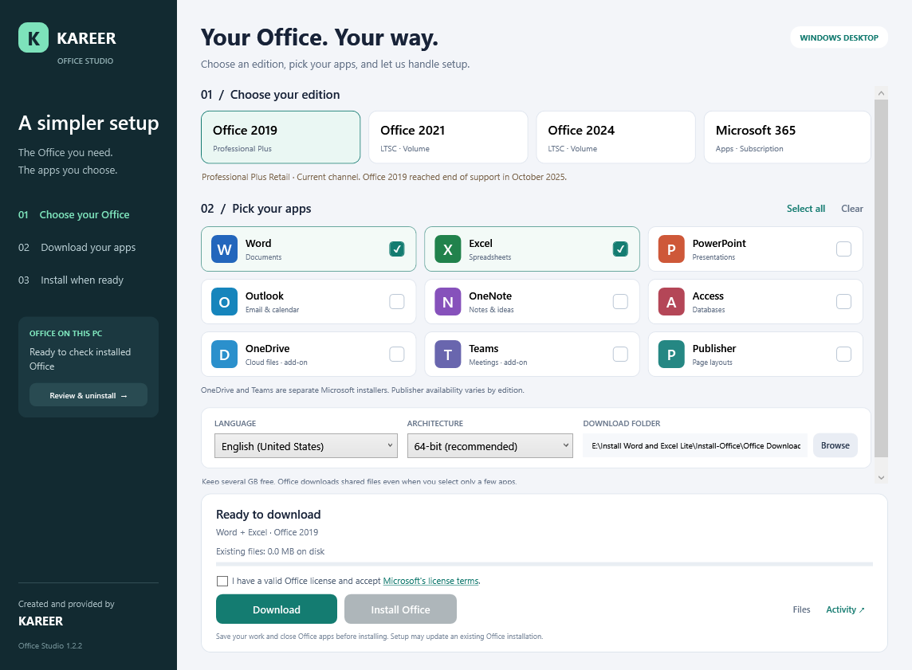
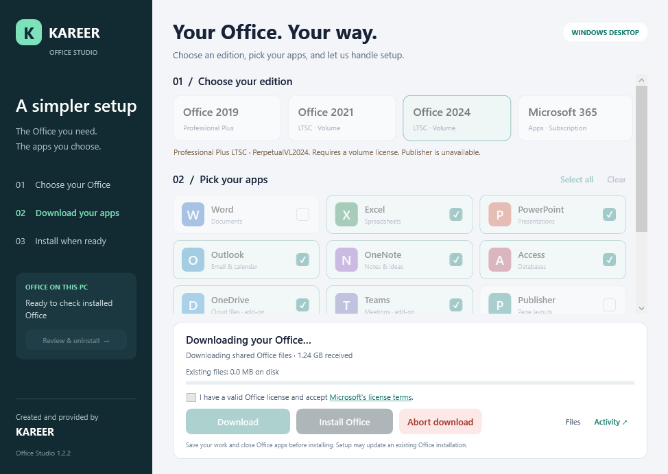

<div align="center">

# Office Studio

### Your Office. Your way.

A Windows desktop app for choosing, downloading, installing, and managing Microsoft Office.

**Created and provided by KAREER**


[](LICENSE)


[Download v1.2.2](https://github.com/ajaykareer/office-studio/releases/tag/v1.2.2) · [Features](#features) · [Build from source](#build-from-source) · [Contribute](CONTRIBUTING.md) · [Release history](CHANGELOG.md)

</div>



Office Studio puts Office edition selection, app checkboxes, download activity, and installation controls in one window. Download the files first, then install when you are ready. No manual PowerShell commands are needed to use the app.

## Getting started

1. Open [Releases](https://github.com/ajaykareer/office-studio/releases/latest) and download **Office Studio 1.2.2.exe** from the release's **Assets** list.
2. Run the EXE and approve the Windows administrator prompt.
3. Select your Office edition and the apps you need.
4. Choose a language, architecture, and download folder, then click **Download**.
5. After the download finishes, accept Microsoft's license terms and click **Install Office**.
6. Open your installed apps and activate them using your own qualifying license or subscription.

The launcher is a single EXE. Office installation files are downloaded separately from Microsoft and require several GB of free space. Keep the downloaded package folder intact if you want to install from it later.

The current EXE is not code-signed; Windows may display an unknown-publisher or SmartScreen warning. You can inspect the source and build it yourself. Release assets include a SHA-256 checksum for checking that your downloaded file matches the published binary.

## Features

| Feature | What it does |
| --- | --- |
| Edition selection | Offers Office 2019, Office 2021 LTSC, Office 2024 LTSC, and Microsoft 365 profiles. |
| App checkboxes | Choose Word, Excel, PowerPoint, Outlook, OneNote, Access, and available optional apps. Includes Select all and Clear. |
| Language and architecture | Eight language choices and 32-bit or 64-bit Office, where supported by Windows. |
| Download activity | Shows existing file size in MB, an animated progress bar, elapsed time, and an activity log. |
| Abort download | Stops the download worker and its child processes while retaining partial files. |
| Automatic file reuse | Checks matching completed packages and reuses matching partial download folders when possible. |
| Separate installation | Downloading does not automatically install Office or its optional addons. |
| Installed Office detection | Displays detected Office products and checks known architecture and installation-type conflicts. |
| Removal tools | Offers standard uninstall and a separate Microsoft cleanup-tool flow after explicit confirmation. |
| Package checks | Checks package hashes and Microsoft installer signatures before installation. |
| Activity logs | View and save activity from inside the app. PowerShell worker windows stay hidden. |



*Screenshots are interface previews generated during testing. Sample progress values are illustrative.*

## Office profiles

| Selection | Product ID | Channel |
| --- | --- | --- |
| Office 2019 | `ProPlus2019Retail` | `Current` |
| Office 2021 LTSC | `ProPlus2021Volume` | `PerpetualVL2021` |
| Office 2024 LTSC | `ProPlus2024Volume` | `PerpetualVL2024` |
| Microsoft 365 | `O365ProPlusRetail` | `Current` |

These are the configuration profiles implemented by the app. Availability and installation compatibility are determined by Microsoft. Your license must cover the chosen product. The 2019 profile preserves the original product/channel selection used for this project.

OneDrive and Teams use separate Microsoft installers. Publisher is offered only in the app's 2019/2021 profiles. At least one Office suite app must be selected.

## Download behavior

- **Shared package:** Microsoft downloads shared Office installation files even when only a few apps are selected. The generated installation configuration excludes unchecked suite apps; selecting only Word does not imply a small Word-only download.
- **Progress:** The Office download does not expose a reliable overall percentage. File sizes can include reserved space and are not a measurement of network bytes received.
- **Resume:** Keep the same edition, architecture, language, and folder. Click **Download** again; matching files are reused automatically where possible. Microsoft may download an incomplete file again.
- **Saved versions:** Reusing a completed package keeps its saved Office build. To request a fresh package, select a different download folder.
- **Abort scope:** Abort applies to downloads. For installation, use Cancel in Microsoft's setup window if offered. Office Studio does not force-kill installations or uninstallations.

Microsoft documents existing-file reuse in the [Office Deployment Tool overview](https://learn.microsoft.com/en-us/microsoft-365-apps/deploy/overview-office-deployment-tool).

## Review and uninstall

Choose **Review & uninstall** to inspect detected products before removing them.

**Standard uninstall** uses Microsoft uninstall mechanisms for supported Click-to-Run Office, registered Office MSI products, and Office Desktop Store packages. Removal can include Project, Visio, and Office language components; it removes Office products rather than individual unchecked apps.

**Deep cleanup** downloads Microsoft's Get Help command-line tool and requests the Office cleanup scenario. It can reset Office settings or licensing and may require a restart. The app scans again afterward and reports remaining products or incomplete results.

Finding an Office installation never automatically removes it. Removal requires explicit confirmation. Documents and Outlook data files are not deletion targets; standalone Microsoft apps and shared components can remain.

## Requirements

- Windows desktop with **.NET Framework 4.8** and **Windows PowerShell 5.1**.
- Administrator access.
- Internet access for downloading packages and cleanup tools.
- Several GB of free space for Office files.
- A valid Office license or Microsoft 365 subscription matching the selected product.

The selected Microsoft product may have additional Windows, hardware, or runtime requirements. Teams also requires a suitable WebView2 runtime. Office Studio is not an activator and does not provide license keys.

## Build from source

Install the **.NET Framework 4.8 Developer Pack**, then run from the repository root on Windows:

```powershell
powershell.exe -NoProfile -ExecutionPolicy Bypass -File .\Launcher\Build.ps1
```

Output: `Office Studio 1.2.2.exe` in the repository root. The interface, PowerShell workers, and icon are embedded in the executable; it still relies on the Windows runtimes listed above.

Run the regression checks on an interactive Windows desktop:

```powershell
powershell.exe -NoProfile -ExecutionPolicy Bypass -File .\Launcher\Build.ps1 -Test
powershell.exe -NoProfile -ExecutionPolicy Bypass -File .\Launcher\Verify-Portable.ps1
```

The tests use synthetic packages and mocked installers. Cancellation tests start harmless temporary processes. They do not install or uninstall Office. Version 1.2.2 also has a startup regression check for asynchronous file-size updates.

### Source layout

```text
Launcher/
  OfficeStudio.cs          Main window, selections, and worker coordination
  MainWindow.xaml         Main interface
  DownloadJob.cs          Scoped download-process cancellation
  DeploymentWorker.ps1    Download, package verification, and installation
  MaintenanceUi.cs        Office inventory and removal interface
  OfficeMaintenance.ps1   Inventory and Microsoft removal-tool integration
  Build.ps1               Single-EXE build
  Test-*.ps1              Offline worker regression checks
  Verify-Portable.ps1     Embedded-resource and standalone packaging checks
docs/images/              Interface screenshots
```

## Troubleshooting and support

Use **Activity** to view or save the log. Local logs and preferences are stored under `%LOCALAPPDATA%\KAREER\Office Studio`.

If version 1.2.1 briefly opens and closes, upgrade to **1.2.2**, which fixes the startup file-size update crash. For other issues, include the app version, Windows version, chosen Office profile, steps to reproduce, and the exact error text when opening an issue. Remove personal paths, account details, and license information from shared logs.

Regression tests cover UI behavior, package validation, cancellation, and mocked removal behavior. Actual Office installation, uninstall, and deep cleanup were not exercised end to end for this release; those outcomes depend on Microsoft's tools and the target PC.

## Contributing

Bug reports, documentation improvements, and proposed fixes are welcome. Please read [CONTRIBUTING.md](CONTRIBUTING.md), work in a fork, and open a pull request. Changes are reviewed by the maintainer before merging. You do not need direct write access to propose an improvement.

## Credits and licensing

**Created and provided by KAREER.** Office Studio is an independent project and is not affiliated with or endorsed by Microsoft. Microsoft Office, Windows, and related names are trademarks of their respective owners.

Microsoft installation packages and deployment utilities are downloaded at runtime and are not distributed in this source repository. Microsoft license terms apply to those products. Office Studio source code is available under the [MIT License](LICENSE). Copyright (c) 2026 Ajay Kareer.
